# Лабораторная работа №5. Чат-боты

**Студент:** Сирош Александр Витальевич, группа ИИ-241
**Дисциплина:** Технологии визуального программирования
**Трек:** C — TypeBot

## 1. Описание выбранного трека

TypeBot — open-source платформа для создания чат-ботов с визуальным редактором. Сценарий строится из групп и блоков: тексты, поля ввода, переменные, условия и интеграции. Бота можно опубликовать по web-ссылке или встроить на сайт.

В работе я:

- зарегистрировался в TypeBot Cloud и создал workspace `Sirosh-II-241`;
- взял готовый шаблон из Templates и русифицировал его (тексты, кнопки, описания, ошибки, плейсхолдеры), проверив, что переменные и логика не сломались;
- создал бота `Sirosh-II-241-bot` — анкету абитуриента с проверкой возраста, переменными и отправкой данных на внешний сервер;
- сменил тему и брендинг, опубликовал бота и экспортировал flow в JSON.

## 2. Ссылка на бота

https://typebot.co/sirosh-ii-241-bot-w3ry96o

## 3. Использованные AI-промпты

1. «Объясни, что нужно сделать в лабораторной по треку TypeBot, и составь план коммитов и структуру папки lab5» — для планирования работы и структуры репозитория.
2. «Дай готового бота для импорта в TypeBot: анкета абитуриента с переменными, условием по возрасту и русскими текстами» — для получения базового JSON-flow, который я импортировал через Import a file и дальше дорабатывал.
3. «Куда добавлять `{{ }}` при русификации блоков шаблона» — чтобы не сломать переменные при переводе.
4. «Как добавить HTTP Request и отправлять данные на webhook.site» — для настройки интеграции.
5. «Что менять в разделах Theme: Templates, Global, Chat, Custom CSS» — для смены темы и брендинга.

## 4. Освоенные блоки и элементы

- **Text bubble** — сообщения бота; в тексте подставляются переменные, например `{{Имя}}`.
- **Text input / Number input** — поля для имени и возраста; ответ пользователя сохраняется в переменную.
- **Variables** — `Имя`, `Возраст`, `Статус`, `Группа`.
- **Set variable** — записывает значение в переменную (`Статус`, `Группа`), в шаблоне также обнуляет `Lead Score`.
- **Condition** — проверяет `Возраст > 17` и направляет диалог в одну из двух веток: «Совершеннолетний» или «Несовершеннолетний».
- **HTTP Request** — метод POST на webhook.site; в теле запроса передаются `Имя`, `Возраст`, `Статус`, `Группа`.
- **Theme** — шрифт, цвета сообщений и кнопок, аватар, брендинг.
- **Publish / Export** — публикация по ссылке и экспорт flow в JSON.
- **Preview** — проверка работы бота перед публикацией.

### Как работает сценарий

1. Группа «Приветствие»: бот здоровается и спрашивает имя (сохраняется в `Имя`).
2. Группа «Возраст»: бот спрашивает возраст (сохраняется в `Возраст`).
3. Группа «Проверка возраста»: Condition сравнивает возраст с 17.
4. Если возраст больше 17, диалог идёт в группу «Совершеннолетний»: `Статус = 'Совершеннолетний'`, `Группа = 'ИИ-241'`, затем итоговое сообщение.
5. Иначе диалог идёт в группу «Несовершеннолетний»: статус другой, и сообщение про законного представителя.
6. Обе ветки сходятся в группе «Отправка данных»: HTTP Request отправляет собранные данные на webhook.site.

## 5. Скриншоты

### Регистрация и workspace
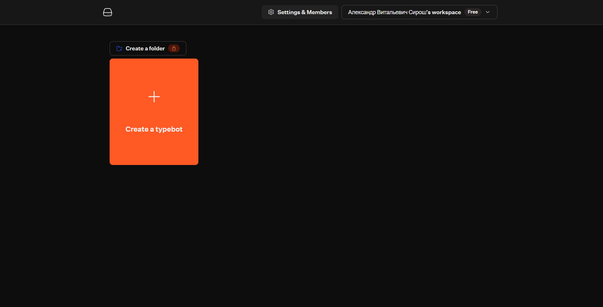
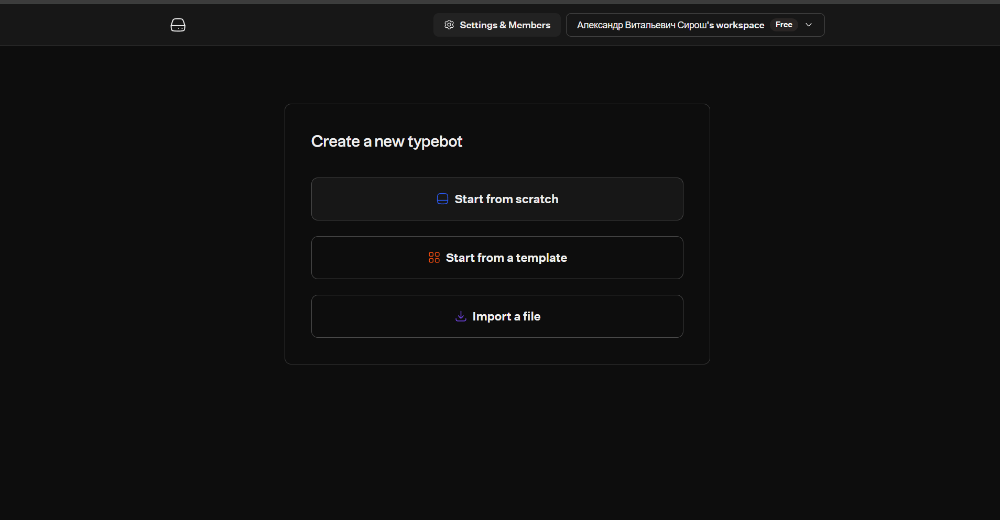

### Шаблон до русификации
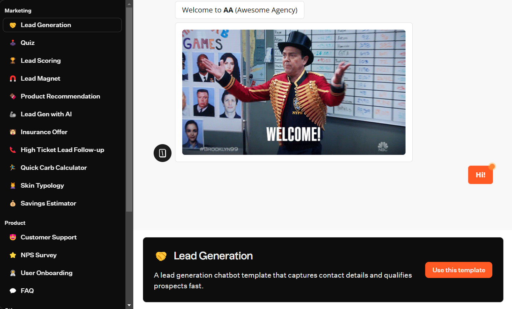
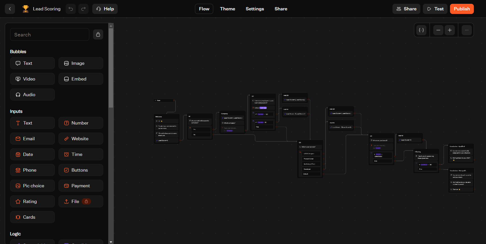
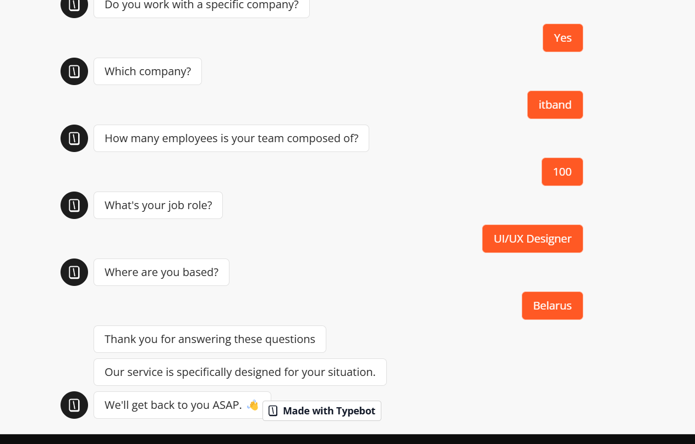

### Шаблон после русификации
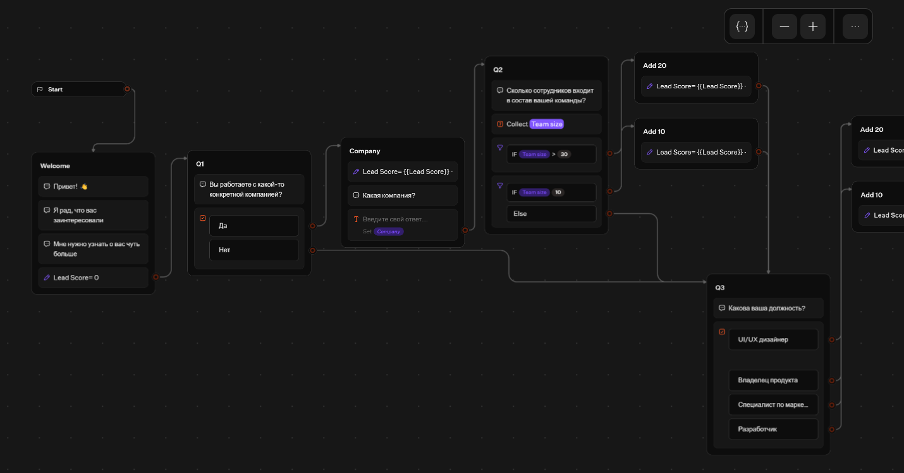
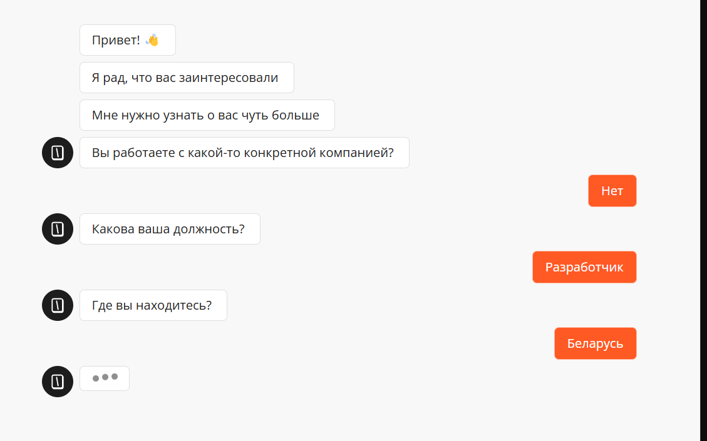

### Мой бот: workflow, переменные, условие
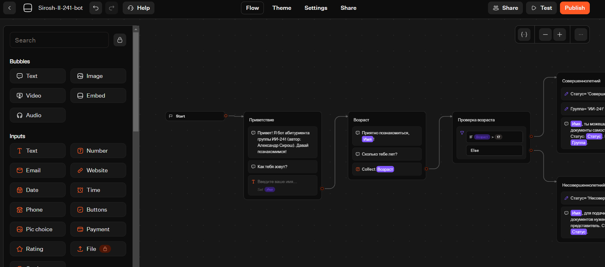
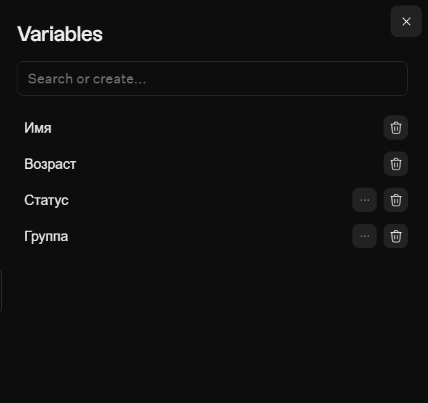
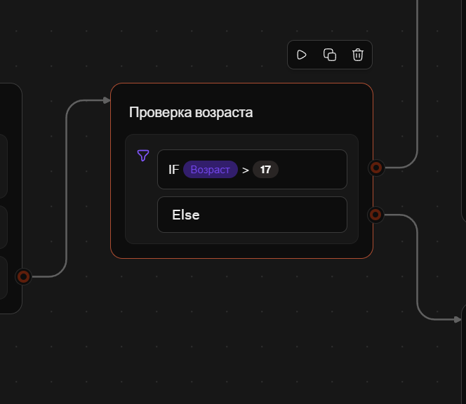
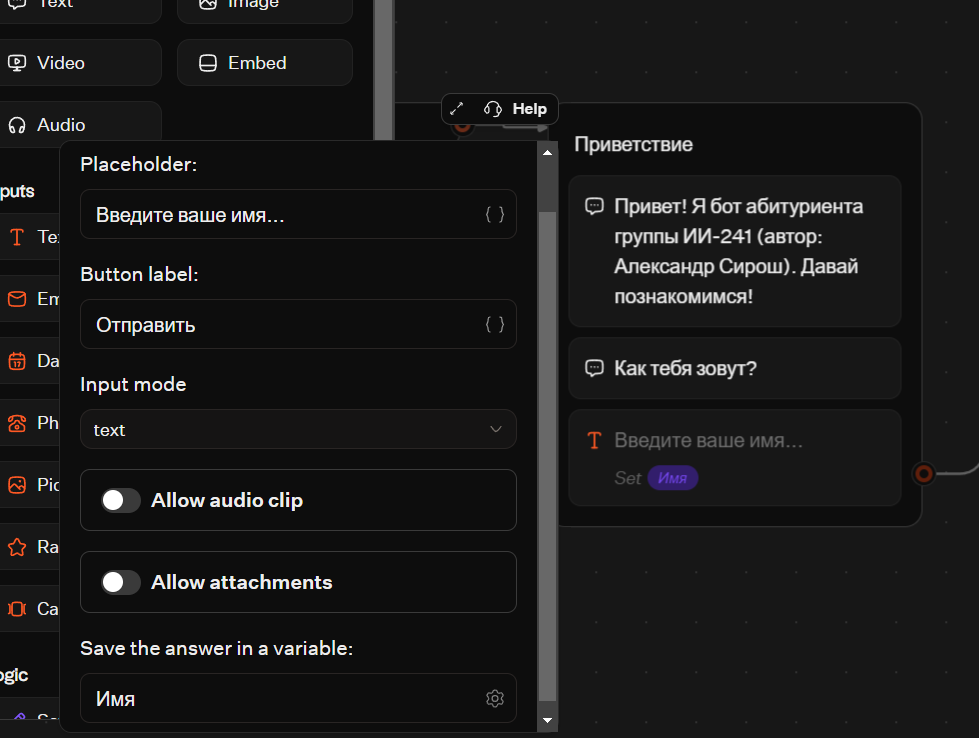

### Интеграция
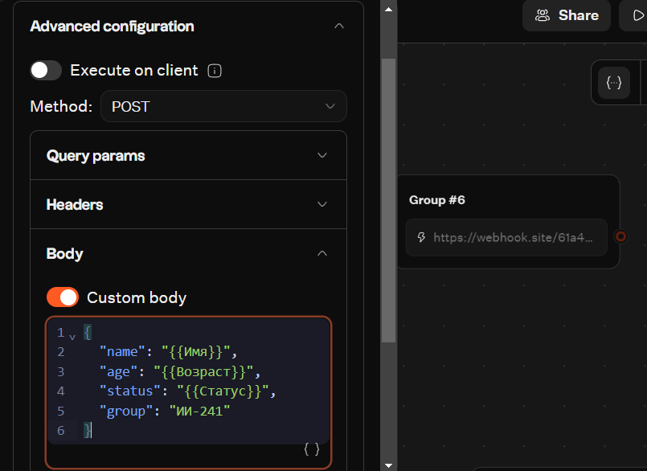
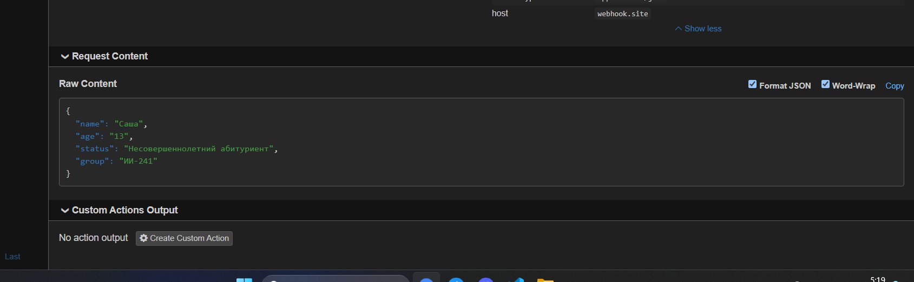

### Тема и брендинг
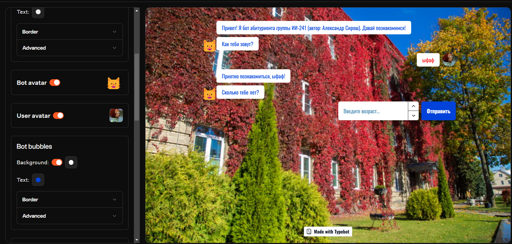

### Результат диалога
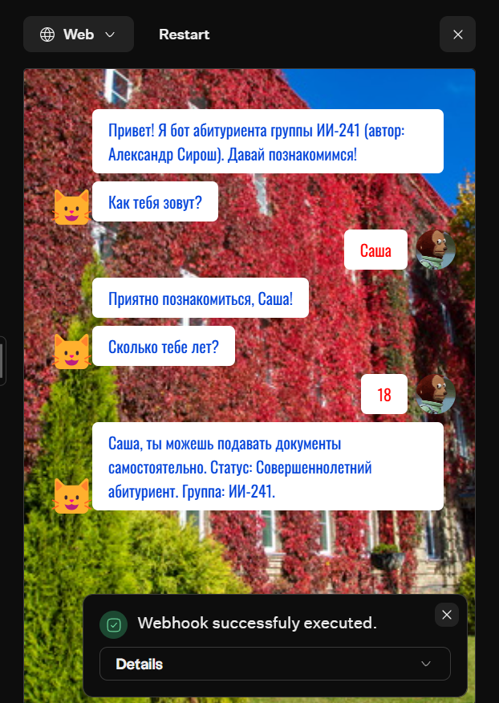
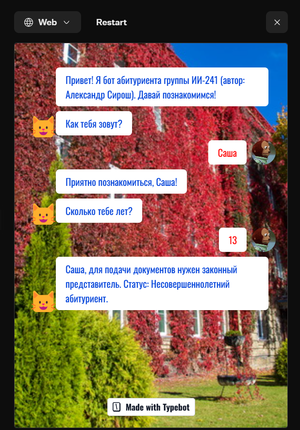
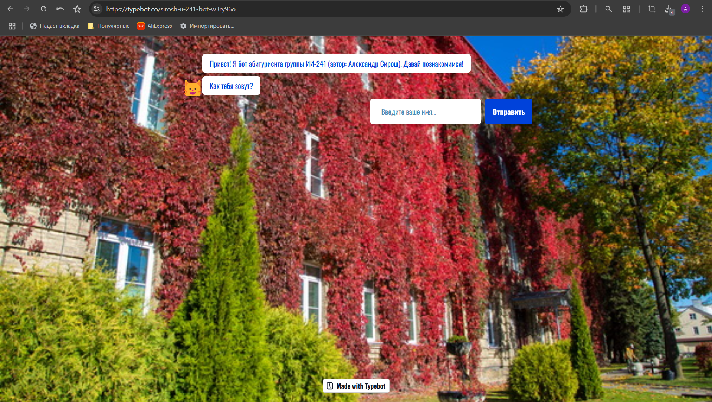

## 6. Экспортированные flow

- `exports/flow-01-template-sirosh.json` — русифицированный шаблон;
- `exports/flow-01-sirosh.json` — итоговый бот `Sirosh-II-241-bot`.

## 7. Выводы

## 7. Выводы

Я познакомился с очень удобным инструментом, который помогает легко создавать ботов под разные задачи. Всё визуально понятно, просто и быстро. Благодаря большому количеству встроенных инструментов (переменные, условия, интеграции, темы, публикация) при разработке не нужно уходить с сайта.